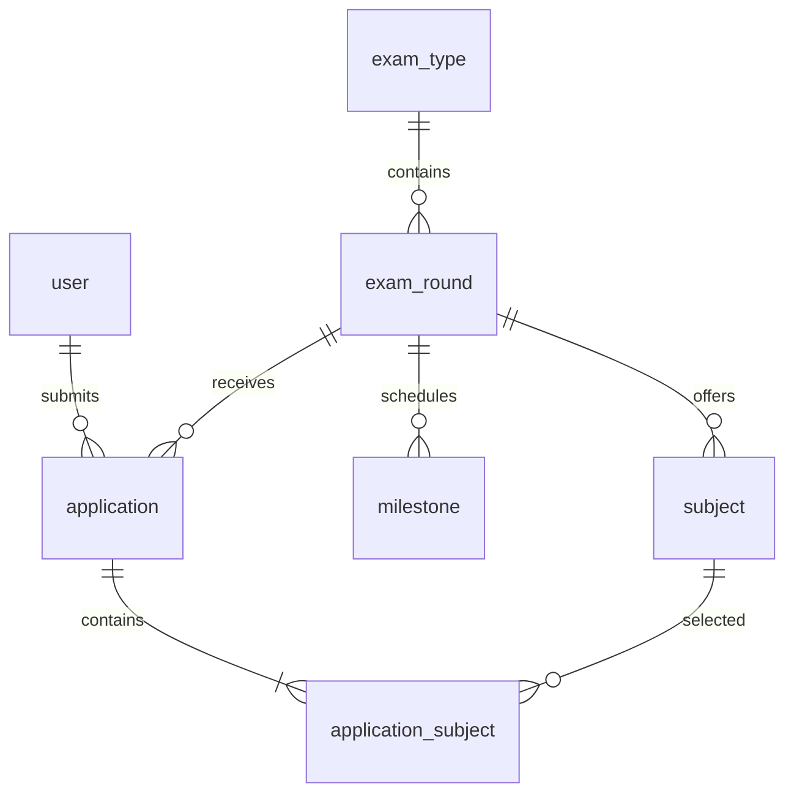

# ระบบรับสมัครและจัดสอบ โรงเรียนท่าศาลาประสิทธิ์ศึกษา

ระบบจัดสอบและรับสมัครออนไลน์ พัฒนาด้วย **Yii 2.0 + MySQL + Tailwind CSS 4**
โค้ดแอปพลิเคชันอยู่ที่รากโปรเจกต์ ส่วนไฟล์ `index.html`, `styles.css`, `script.js`
คือ mockup เดิมที่เก็บไว้เป็นข้อมูลอ้างอิง แอปจริงใช้ `web/index.php`

## สถานะงานชุดแรก

| ส่วนงาน | ความสามารถที่ใช้งานได้แล้ว |
| --- | --- |
| บัญชีผู้ใช้ | ผู้สมัครใช้เลขบัตรประชาชนและวันเกิด 8 หลัก (ววดดปปปป พ.ศ.) เจ้าหน้าที่ใช้อีเมลและรหัสผ่าน |
| ประเภทการสอบ | สร้างและแก้ไขประเภทการสอบ |
| รอบสอบ | สร้าง แก้ไข เปิดเป็นแบบร่าง เผยแพร่ ปิด และกำหนดช่วงเวลารับสมัคร |
| รายวิชา | สร้างและแก้ไขรายวิชาในแต่ละรอบ วันเวลา สถานที่ จำนวนที่นั่ง ค่าสมัคร และสถานะ |
| กำหนดการ | แสดงวันเปิด/ปิดรับสมัคร วันสิ้นสุดชำระเงิน และสร้าง/แก้ไขกำหนดการเพิ่มเติมรายรอบ |
| เอกสารที่ต้องใช้ | กำหนดชื่อเอกสารรายรอบสอบ |
| รับสมัคร | สมัครสอบได้ทันที กรอกชื่อ เลขบัตร วันเกิด เลือกวิชา และยืนยัน ระบบสร้างบัญชีพร้อมใบสมัคร ไม่มีหน้าสมัครสมาชิกแยก |
| ตรวจสอบเงื่อนไข | ป้องกันสมัครรอบเดิมซ้ำ วิชาคนละรอบ วิชาปิดรับ วิชาที่เต็ม และเวลาสอบซ้อนกัน |
| ติดตามใบสมัคร | ผู้สมัครเห็นใบสมัครตนเองและยอดรายวิชา ผู้ดูแลเห็นรายการผู้สมัครทั้งหมด |

ยังต้องพัฒนาต่อ: การตรวจ/อนุมัติเอกสาร การรับชำระเงินจริง
กระทบยอด/คืนเงิน สิทธิ์เจ้าหน้าที่อีก 4 กลุ่ม การจัดห้องและที่นั่งสอบ บัตรสอบ คะแนน
ประกาศผล รายงานการเงิน และ audit log รายละเอียด สถานะการชำระเงินปัจจุบันเป็น “ยังไม่ชำระ”
ไม่มีการเชื่อมธนาคารหรือรับชำระจริงในชุดนี้

## กรอกกำหนดการพร้อมรอบสอบ

หน้าสร้าง/แก้ไขรอบสอบมีส่วนกำหนดการในหน้าเดียว เพิ่มชื่อกิจกรรมได้อิสระ
หรือเลือกจากรายการที่ใช้บ่อย เช่น วันสอบ ประกาศผล รายงานตัว และมอบตัว
แต่ละรายการมีวันเวลาเริ่ม วันเวลาสิ้นสุดถ้ามี สถานที่/ช่องทาง และรายละเอียด
เพิ่ม แก้ไข หรือลบได้ไม่เกิน 50 รายการ แล้วกดบันทึกรอบสอบครั้งเดียว
วันเปิดสมัคร ปิดสมัคร และสิ้นสุดชำระเงินใช้ข้อมูลหลักด้านบน ไม่ต้องกรอกซ้ำ

ข้อมูลรอบสอบและกำหนดการบันทึกใน transaction เดียว หากรายการใดไม่ถูกต้อง
จะไม่บันทึกส่วนอื่น และมีการตรวจ revision ป้องกันการเขียนทับกำหนดการจากอีกหน้าต่าง
กำหนดการที่บันทึกแสดงในหน้ารอบสอบของเจ้าหน้าที่และหน้าสมัครของผู้สมัคร
รายการวันสอบในกำหนดการเป็นข้อมูลประกาศ เวลาสอบรายวิชาที่ใช้ตรวจเวลาซ้อนยังตั้งในรายวิชา

```sh
npm run test:schedule
```

## รับนักเรียนตามตัวอย่างประกาศเดิม

รองรับรอบสอบแบบ `admission` แยกจาก `subjects` เดิม ผู้ดูแลเพิ่มโครงการ ม.1/ม.4
กำหนดจำนวนรับ เกณฑ์เกรด เกรดภาษาต่างประเทศ ชุดวิชาบังคับ และค่าสมัครต่อโครงการได้
แบบฟอร์มนี้บันทึกโรงเรียนเดิม ผลการเรียน ข้อมูลติดต่อ ผู้ปกครอง และอัปโหลดเอกสารแล้ว
ผู้สมัครและผู้ดูแลเปิดรายละเอียดใบสมัครและดาวน์โหลดเอกสารตามสิทธิ์ได้
การตรวจ/อนุมัติเอกสารโดยเจ้าหน้าที่ยังต้องพัฒนาต่อ

```sh
php yii admission-example
npm run test:admission
```

คำสั่งสร้างตัวอย่าง ม.1 และ ม.4 จากประกาศปี 2569 เป็น draft พร้อมลิงก์ preview ในผลคำสั่ง
ไม่ได้เปิดรับสมัครด้วยวันที่เก่า รายละเอียดและสิ่งที่ยังต้องพัฒนาต่ออยู่ใน `docs/admission-design.md`

ตามคำสั่งเปิดรับสมัคร ข้อมูลในเครื่องนี้เปลี่ยนเป็นรอบรับสมัครจริงผ่าน
`php yii admission-example/activate` แล้ว ชื่อและข้อความตัวอย่างถูกนำออกจากหน้ารายการหลัก
คำสั่งนี้ปรับกำหนดการและวันสอบของรอบที่ยังเป็นตัวอย่างและยังไม่มีผู้สมัคร ให้เปิดรับในวันสั่งงาน
ถึงอีก 20 วัน ชำระได้ถึงอีก 22 วัน และสอบอีก 30/31 วัน โดยเรียกซ้ำแล้วไม่เลื่อนวันที่รอบที่เปิดแล้ว
สามารถปรับกำหนดการต่อได้ในหน้าแก้ไขรอบสอบ ลิงก์ preview เดิมของรอบที่เผยแพร่จะส่งต่อไปฟอร์มสมัครจริง

## เปิดใช้งานในเครื่อง

ต้องมี PHP 8.2+ พร้อม PDO MySQL, mbstring, intl/ส่วนขยายที่ Yii ต้องใช้, Composer,
MySQL และ Node.js LTS สำหรับ build CSS/JS ตั้ง document root ที่ `web/` เท่านั้น

```sh
composer install
npm ci
```

สำหรับเครื่องพัฒนาใหม่ที่ MySQL root เชื่อมต่อในเครื่องได้ และยังไม่มีฐาน `examops_dev`:

```sh
php scripts/setup.php
php yii migrate --interactive=0
php yii seed
npm run build
php -S 127.0.0.1:8080 -t web web/router.php
```

เปิด http://127.0.0.1:8080 และใช้บัญชีผู้ดูแลที่สร้างไว้ใน `runtime/dev-access.txt`
ที่หน้า `/site/staff-login` ส่วนผู้สมัครเข้าสู่ระบบที่ `/site/login` ด้วยเลขบัตรและวันเกิด
สมัครสอบครั้งแรกได้จากหน้ารอบสอบโดยตรง ลิงก์เก่า `/site/register` จะกลับไปหน้ารอบสอบ
เช่น 1 มกราคม 2540 ใช้ `01012540` มีการตรวจเลขตรวจสอบบัตรและวันเกิดจริง
วันเกิดที่ใช้เข้าสู่ระบบเก็บเป็น password hash และจำกัดการลองข้อมูลผิดตาม IP/เลขบัตร
รหัสผ่านสุ่มใหม่เมื่อตั้งต้นข้อมูลครั้งแรก บัญชีนี้เป็นบัญชีสำหรับเครื่องพัฒนาเท่านั้น
คำสั่ง seed ไม่ล้างข้อมูลเดิมและจะข้ามเมื่อมีผู้ใช้แล้ว วันในข้อมูลตัวอย่างคำนวณจากวัน seed

`scripts/setup.php` สร้างฐานใหม่และผู้ใช้ MySQL เฉพาะฐาน พร้อม `.env` ที่มีรหัสผ่านสุ่ม
ถ้ามี `.env` อยู่แล้วจะไม่เขียนทับ สามารถกำหนด MySQL สำหรับขั้นตอน setup ผ่าน
`SETUP_MYSQL_DSN`, `SETUP_MYSQL_USER`, `SETUP_MYSQL_PASSWORD`
สำหรับเซิร์ฟเวอร์อื่นใช้ `.env.example` เป็นแนวทางตั้งค่าเชื่อมฐานที่จัดเตรียมไว้
และตั้ง `APP_ENV=prod`, `APP_DEBUG=0`, `APP_COOKIE_KEY` เป็นค่าสุ่มอย่างน้อย 32 ตัวอักษร

## โครงสร้างข้อมูล



- 1 ใบสมัครต่อผู้ใช้ต่อรอบ เลือกได้หลายวิชา ราคาต่อวิชาจะถูกบันทึกลงใบสมัคร ณ วันสมัคร
- สมัครสำเร็จแล้วจะสำรองที่นั่งทันที แม้ยังไม่ชำระ การหมดอายุและคืนที่นั่งจะทำในงานการเงิน
- กำหนดการเปิด/ปิดสมัครและสิ้นสุดชำระเงินมาจากข้อมูลรอบโดยตรง รายการเพิ่มเติมเก็บใน milestone
- เวลาสอบแต่ละวิชาเป็นข้อมูลที่ใช้ตรวจการซ้อนกัน รายการ “วันสอบ” ในกำหนดการเป็นข้อมูลประกาศ
- ทุกเวลาใช้ Asia/Bangkok และแสดงปี พ.ศ. ในหน้าจอ
- การยืนยันใบสมัครใช้ transaction และล็อกแถวรอบสอบก่อนตรวจจำนวนที่นั่ง

## ทดสอบ

```sh
composer test
npm run test:e2e
```

Domain tests ใช้ MySQL จริงและ rollback ข้อมูลทดสอบ Browser tests ต้องเปิดเซิร์ฟเวอร์
และมีบัญชีจาก seed โดยจะสร้างข้อมูลทดสอบชั่วคราวแล้วลบเฉพาะข้อมูลของการรันทดสอบนั้น
ภาพหน้าจออยู่ที่ `tests/artifacts/` หากเครื่องยังไม่มี Chromium ให้รัน
`npx playwright install chromium` ก่อน

## ข้อมูลที่ต้องเตรียมสำหรับงานถัดไป

1. ชื่อหน่วยงาน โลโก้ และผู้มีสิทธิ์ใช้งานแต่ละบทบาท
2. ประเภทสอบ รอบสอบ รายวิชา วันเวลา จำนวนที่นั่ง ค่าสมัคร และกำหนดการจริง
3. แบบฟอร์มข้อมูลผู้สมัคร เอกสารที่ต้องแนบ และเกณฑ์อนุมัติ
4. ช่องทางรับชำระเงิน รูปแบบใบเสร็จ การหมดอายุใบสมัคร และนโยบายคืนเงิน
5. สนามสอบ อาคาร ห้องสอบ รูปแบบบัตรสอบ และกติกาประกาศผล

บัญชีธนาคารและข้อมูลเชื่อมบริการจริงให้ตั้งผ่านช่องทางเก็บความลับตอนเชื่อมระบบ
ไม่ต้องบันทึกใน repository

เอกสารอ้างอิง:
[Yii2](https://www.yiiframework.com/doc/guide/2.0/en/start-installation),
[Tailwind CLI](https://tailwindcss.com/docs/installation/tailwind-cli)
